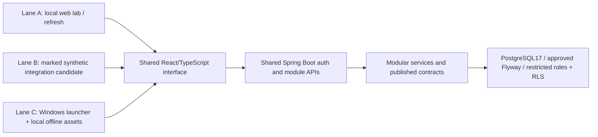

# AroNexa web-first delivery audit and first bounded improvement

**Product remains NOT_READY. No Central PASS, customer approval, clinical API activation, governance waiver, original-database operation, merge or installer redesign.** This is an internal workflow increment, not the completed application.

## A. Five verified bottlenecks and shortest safe route

Read-only source/provider audit preceded implementation. Snapshot: product main `928c4d4e015628b6a198aa13e638427aac53b90d`; most complete inspected candidate `ce0ed7b56d8293a0f74421974b459e6c420969c5` (draft148); QA main `a7d0906937368d5968b96ab956629a584fe543f0`, QA37 `f9edd6b8ce984e29802cc56d16e21989b1d8f7a7`. Historical passes are not current tooling-head acceptance. [Full open-PR map](INTEGRATION_MAP.csv) records every fetched open product/QA head/base and age. No candidate was merged.

| Priority / verified evidence | Root cause and effect | Bounded remedy / verification |
|---|---|---|
| High:42 open product PRs, all draft;148 depends through34 open PRs to102; main/candidate divergence1/415 | Main frontend is still a foundation scaffold; coherent candidate code is trapped in stacked branches. PR count/age are measured; engineering delay hours are not. | One pinned candidate inventory; review oldest dependency boundaries in bounded batches, preserve branches, no broad merge. Exact-candidate regression after any approved reconciliation. |
| High: normal candidate App.tsx imports demoRegistration/seedPatients and in-memory appointments | A root-page demo is mistaken for the separate connected interface. Registration POST remains test-only/inert in normal runtime; packaging cannot make it production-connected. | Reuse connected-reception component/API clients and approved production-intended services. Complete reviewed registration writer/migration/provisioning slice; never enable test controllers for clinics. Verify real auth+HTTP+PG+browser. |
| High: existing connected operator entrypoint requires Windows; dev Compose uses reusable named volume at5433; script dev_runtime_acceptance is CI-only | No uniform marked fresh local web lab exists for the complete application; generic dev stack and Windows operator kit serve different purposes. | First improvement reuses Windows Pilot09 lab and adds explicit safe STOP plus focused feature feedback. Complete cross-platform actual runtime lab only after approved writer boundaries; no installer/jlink requirement for future web iteration. |
| High: Test-Opd-Registration-Increment.ps1 always npmci -> full frontend build/tests/previews -> connected build -> selected HTTP -> clean full verify | Repeated full work for every feedback pass; plain verify includes guarded methods, while current opt-in Maven matrix separates consent/phase execution. Actual code flow verified; historical duplicated wall time not invented. | Additional explicit Developer/Feature command: bounded test selection, fresh inventory/report path, no clean/global consent, no CI/handoff policy replacement. Keep required full matrix separately. |
| High:QA38 has eight guarded methods NOT_RUN, no real independent operator/reviewer, no matching Central status; API403 administration reads remain UNKNOWN | Genuine acceptance/configuration obligations remain unmet. Owner's two usernames are the same person. Routine workflow fixes and customer/independent acceptance are different claims. | Continue authorized tooling/owner-local feedback; retain rule27 hold. Obtain qualified independent human, reviewed isolation/exception and capable admin. Any QA-frequency/handoff amendment remains proposed until approved. |

Shortest safe path: reuse candidate148's connected UI, actual auth, read/intake/guarded booking services, test-proven SQL and current Node/Maven tools. Make the existing synthetic lab easy to locate/start/stop now. Next, one reviewed production-intended registration write boundary and migration/key lifecycle must replace the test-only registration dependency. Extend the same app through appointments/queue, consultation/history, reviewed Rx/forms, billing/reports. Windows packaging remains a separate release adapter. #72/#124 already explicitly allow WIN11B development alongside #143 signing/retention; a policy that forces routine work to wait for a certificate is NOT established by this audit.

## B. Current integration and feature inventory

[FEATURE_INVENTORY.csv](FEATURE_INVENTORY.csv) records requirement IDs, roles, implementation paths, branch/PR provenance, frontend/API/persistence, QA scope, gates and remaining work. `PERSISTENT` explicitly scoped TEST ONLY is a real PostgreSQL proof, not a deployed production capability. `REAL_API_CONNECTED` may be partial/read-only/default-off; it is not INTERNAL_ACCEPTED or CUSTOMER_RELEASE_APPROVED. No feature is marked customer-approved. Normal App.tsx remains MOCKED; main remains scaffold-only.

Key dependency chain (leaf to root):148 ->147 ->145 ->142 ->141 ->140 ->139 ->138 ->137 ->136 ->134 ->133 ->132 ->131 ->130 ->129 ->128 ->127 ->126 ->125 ->122 ->121 ->120 ->119 ->118 ->116 ->115 ->114 ->113 ->112 ->111 ->110 ->108 ->102. The complete CSV also records side branches, including migration/Windows proofs; these must not be silently dropped or merged en masse.

Issues:72 preserves commercial scope and parallel delivery;124 retains Windows/offline/recovery release obligations;135 retains persistent Reception/restart;143 is bounded artifact retention/signing;146 tracks actual persistent Windows runtime. PR131 is connected TEST-ONLY cross-role UI;133/134 add default-off production-intended intake/booking;136–139 improve Reception continuity/search/browser restart;140 is operator kit;141 encrypted disposable recovery proof;142 native shell;145 portable runtime;147/148 source handoff/lifecycle. A missing number in131–148 may be an issue, not a PR. QA38/37 remain independent WIN acceptance preparation, not permission to reuse their26-path allowlist for this new tooling branch.

Best code-reuse candidate is ce0ed7b, not main; best release candidate is NONE accepted. This tooling branch starts at that exact code but adds only scripts/docs; it does not assert any ancestor PASS for its new SHA. Review-only source integration plan:
1. Freeze/source-audit the candidate and V1–V9 main differences; retain all branch refs/worktrees and unchanged original DB.
2. Reconcile auth/patient identity/read boundaries and reviewed registration migration/provisioning before enabling a persistent writer. Do not copy nested test controllers to production.
3. Reconcile restricted booking/queue and cross-module identifiers, transaction/audit/revocation semantics; no disconnected appointment state.
4. Add consultation/history, Rx finalization/amendment/ink/print and financial/reporting slices through shared modules. Test source/destination identity and security after every approved boundary.
5. Publish/merge only through explicit review/authorization; main/candidate content differs, so never use main's green checks for candidate code.

Authority inspected: both AGENTS.md; docs/requirements/TRACEABILITY.md; PHASE_REGISTER.md; architecture/ARCHITECTURE.md and PHASE_00_DECISION_BASELINE.md; releases/RELEASE_GATE.md; OPD_V1_PERSISTENT_JOURNEY_CONTRACT.md and phase/source docs. The standalone full Master Contract V3 text and original phase-prompt series were not found in available files; their absence is explicitly noted in existing traceability. No new requirement mapping, scope reduction or phase reassignment is inferred. #72 and this owner instruction preserve Windows-first commercial release despite older architecture prose listing web/SaaS before Windows.

## C. Web-first target architecture



One business implementation; three environment adapters. LaneA validates tools, provisions ONLY fresh marked disposable PG17 and approved migrations, starts actual backend/Vite and reports real auth/DB availability. LaneB freezes SHA/request/run/marker and executes real HTTP/browser/persistence/security/restart. LaneC packages those already-verified modules with localDB/licensing/printing/encrypted recovery/upgrade and Windows acceptance. Development-only loopback does not authorize public SaaS hosting. Existing test controllers stay labelled test-only until a reviewed runtime implementation exists.

The new launcher is deliberately a narrow reuse of existing Windows Pilot09; it is NOT the completed cross-platform production-intended LaneA. It needs installed developer JDK21/Maven/Node24/Linux-container Docker, not an EXE, signing certificate, installer or bundled Java. No second UI/backend is created.

## D. Lean delivery / QA operating model

Feature definition -> bounded implementation -> local browser observation -> focused QA -> one integrated candidate -> owner functional acceptance -> release packaging. One primary product integration WIP; signing/retention may proceed on separate nonoverlapping tooling paths. A qualified independent human is still required wherever the existing gate requires one; owner and AI review remain explicitly labelled.

| Level | Evidence | Current change |
|---|---|---|
|1 Developer | Selected unit/model/contract checks + relevant type/lint | New manual Developer command; no acceptance claim |
|2 Feature | Actual HTTP/PG persistence, negative auth/RLS and browser for the affected vertical slice | New manual Feature command runs selected HTTP proofs; it explicitly leaves browser/full acceptance NOT_RUN. It does not alone complete Level2. |
|3 Candidate | Full required matrix + cross-role/shared identity + distinct-process restart + full negatives | Existing mandatory gates unchanged |
|4 Windows/release | Offline/installer/signing/license/recovery, clinical/privacy/security/accessibility, genuine independent reviews and owner release | Unchanged; NOT_READY |

Definition of Done for a vertical slice: usable shared UI; real runtime API; persistent same-record behavior after reload/restart; proper role/object/RLS/session controls; errors/idempotency/concurrency; focused regressions and actual browser workflow; exact SHA and honest failures; required review/owner disposition. Draft Rx does not satisfy clinical finalization; test PG does not prove clinical migration or second-PC restore.

GOV-WEB-01 (PROPOSED, NOT APPROVED): formally distinguish routine developer feedback from integration/release handoff frequency; run mandatory full candidate evidence once per required immutable candidate, project security/phase results without duplicate counting, and reserve Windows packaging acceptance for its adapter boundary. No rule27 wording, workflow trigger, required check, review rule, frequency or approval requirement is changed here. Approval of this amendment is needed before changing those controls; this added local command is not a substitution.

## E. Executable local lab and feedback commands

Use a clean checkout of the new tooling commit, substitute its actual full SHA for TOOLING_SHA. Do not use ce0ed7b as if it contained these new files. Private reports must be NEW directories OUTSIDE the checkout. Commands are PowerShell; pwsh can execute focused tests on Linux, while the inherited interactive lab remains Windows-only.

```powershell
# Read-only prerequisites + candidacy status; no containers or services started.
.\scripts\Start-AroNexa-WebLab.ps1 -ExpectedCommit TOOLING_SHA -CheckOnly

# Windows owner-local SYNTHETIC lab; explicitly confirm scope yourself.
.\scripts\Start-AroNexa-WebLab.ps1 -ExpectedCommit TOOLING_SHA -ConfirmFictionalDisposableLab

# RunDirectory is the exact pilot09 session folder printed by the owning launcher.
.\scripts\Stop-AroNexa-WebLab.ps1 -ExpectedCommit TOOLING_SHA -RunDirectory 'EXACT_OWNED_PILOT09_FOLDER'

# Fast pure frontend/model/client feedback (no npmci, Maven or installer).
.\scripts\Test-AroNexa-Feature.ps1 -Flow Reception -Level Developer -ExpectedCommit TOOLING_SHA -ReportDirectory 'NEW_PRIVATE_OUTPUT_DIRECTORY'

# Selected current-source discovery + real HTTP/PG17 proofs.
.\scripts\Test-AroNexa-Feature.ps1 -Flow Reception -Level Feature -ExpectedCommit TOOLING_SHA -ReportDirectory 'ANOTHER_NEW_PRIVATE_OUTPUT_DIRECTORY'
```

Start reuses scripts/pilot/Start-AroNexa-WindowsAssistedPilot.ps1. Existing lab URL: http://127.0.0.1:5176/connected-reception-preview.html. It starts real Spring test-profile HTTP services plus fresh labelled PG17 and the existing connected UI, with private fictional staff sheet and45minute bound. It is an owner-local TEST LAB, not a production-connected or independent Central acceptance. No acknowledgement or human receipt is synthesized by the new wrapper. If5176 belongs to another session, stop; do not kill or switch it silently. Existing Pilot09 internally retains its tool/dependency setup; cached launcher start time improvement is not claimed or measured here.

STOP validates dedicated lab root, pilot09 UUID name, exact-source marker and every path ancestor/reparse point. It creates a new STOP control file only; it never kills processes, prunes Docker or connects a DB. STOP_REQUESTED is not proof of completed teardown: the existing owning harness must verify its exact resource identity and cleanup. Interrupted/host-loss lab recovery remains a separate evidence requirement.

Feature selection:9 existing Node files; fresh inventory discovery; RegistrationCandidateHttpAcceptanceTests + PatientCandidateSearchHttpAcceptanceTests + ordinary AppointmentCandidateHttpAcceptanceTests, using opt-in ordinary tag filtering to avoid phase/operator consent fabrication. Exactly selected discovered IDs must be present once; failure/error/skip/missing/duplicate/parser/child-cleanup issues fail. Runtime fork-shutdown ERROR fails the feedback result even if XML assertions pass; Hikari closed-connection warnings block lifecycle clearance. Parent credentials, inherited DB/profile/pilot/JVM/Node overrides are refused; controlled child helper strips credential overrides too. Logs remain private; feedback.json contains source SHA, selections, counts, outcomes and duration. No Central status or independent receipt is written.

The underlying lab's complete Windows session is NOT_RUN here. CheckOnly reports BLOCKED on this Linux machine and is not a startup PASS. Normal runtime registration/complete clinical journey remains BLOCKED. Only Reception is currently an implemented selection; other feature names are refused, not pretended supported.

## F. Reception acceptance demonstration — exact limits

The first tooling checkpoint2abdc2f executed99frontend checks, discovery1 and38real HTTP/PG17 selected cases in93.742seconds (0failures/errors/skips), with authenticated registration Node-wire and separate persisted booking/check-in/daily queue proofs. These classes do NOT establish one new browser-created end-to-end registration->booking->check-in->queue journey: appointment fixtures seed pre-existing registrations, and true browser RC03/Pilot06 methods remain guarded. Full F browser/production-runtime demonstration is NOT_RUN/BLOCKED, not PASS. Prior RC03 owner evidence at ancestor heads is historical only. The existing UI/operator lab is the reusable route for a real person after its genuine prerequisites/consent, not another disconnected demo.

A missing approved registration writer/V10/key lifecycle is the concrete production-runtime blocker; absence of an EXE is not its cause. No original/customer DB, Flyway V10 promotion, production clinical endpoint or review-gated activation was performed to manufacture a demonstration.

## G. Prioritized dependency backlog

| Priority/task | Dependency | Outcome and acceptance |
|---|---|---|
|P0.1 One candidate / integration ledger | Current source/provider audit | Keep exactSHAs, source dependencies, blockers and named owner; no broad merge42PRs |
|P0.2 Reusable local feedback (this PR) | Existing connected lab/tests | Start/STOP preflight/refusal and selected HTTP counts tested; Windows launch explicitly pending |
|P0.3 Production-intended Registration slice | Reviewed V10, nonowner writer/proof-key lifecycle, encrypted migration/recovery rehearsal, independent security review | Real auth+duplicate review+registration+patient detail using persistent runtime; no test-controller copy/hidden mock fallback |
|P0.4 Complete real LaneA start/stop/readiness | P0.3, approved bootstrap/onboarding | Fresh markedPG17 V1+authorizedlater migrations; real Spring dev+Vite refresh; browser auth/DB availability; private synthetic data; safe own cleanup. Measure3starts. |
|P1.1 Appointment/queue runtime | Same registration identity + reviewed restricted command boundary | Available doctor/slot, book/check-in, queue/cancel/reschedule, conflict/idempotency/RLS tests |
|P1.2 Consultation/history | Persistent checked-in visit | Same patient/encounter, authorization, immutable audit, stale revision/revocation and restart/history |
|P1.3 Rx + clinical forms/ink + print | P1.2 + clinician-reviewed contract | Full approved mouse/touch/stylus, structured medication, clinical history, finalization/amendments/printing; no scope deferral |
|P1.4 Billing/receipts/reports | Same encounter, financial contract | Durable invoices/payment events and daily reports; concurrent overcollection/reversal/role/tenant negatives |
|P1.5 End-to-end candidate regression | P1.1–4 | Same clinical identity across all roles, browser/restart/full negative matrix on exact candidate; all mandatory methods accounted |
|P2.1 Existing Windows packaging adapter | Verified app candidate; #143 in parallel | Retained app-image/JAR/UI, actual startup/reboot, final-byte checksum+real signing state; previous verified output preserved |
|P2.2 Offline operational contract | P2.1 + licensing/recovery review | No required internet/developer tools, localPG/persistence, printing, first-run, signed renewal/clinical continuity, encrypted full schema recovery on second machine, upgrade/rollback |
|P2.3 Independent acceptance/release | All applicable clinical/security/privacy/accessibility/recovery requirements | Real qualified humans and owner release decision; NOT_READY until actual evidence |

Safe parallel work: read-only audit/traceability and script unit tests; bounded signing/artifact retention versus clinical backend on nonoverlapping paths; clinician/security contract review while developer works on a separately authorized slice. Do not parallel-edit shared controllers/migrations or launch duplicate candidates against shared DBs. Any source merge/rebase invalidates old exact-head execution evidence for the resulting candidate.

## Windows packaging comparison

A. Existing Java launcher + locally served React: RECOMMENDED smallest adapter. Reuse Windows runtime scripts/JAR/UI and localPG; complete actual persistent backend before calling its shell functional. Installer includes JDK-derived runtime and PostgreSQL, starts localhost with reviewed sessions, supplies offline print/licence/encrypted recovery/upgrade. No manual Docker/JDK for clinic staff.

B. Lightweight webview launcher: only after evidence that default browser lifecycle/printing/offline UX is inadequate. Adds WebView2 distribution/offline and patch responsibilities; does not solve API/persistence. No implementation authorized by this comparison.

C. Alternative desktop wrapper: no source-backed maintenance/risk benefit established; do not introduce a second framework/backend. Windows release/testing stays mandatory; web feedback needs no installer/certificate. Public SaaS deployment remains separately gated.

## Delivery metrics and targets

Measured:42open product drafts at audit;34deep leaf dependency chain; oldest open timestamp2026-11-11T09:29:59Z (CSV ages are elapsed days, not engineering effort). 0/6 requested FULL production-intended clinic flows independently accepted. Partial persistent test proofs are not counted as complete clinical flows. No defensible percentage of all contractual features is inferred from test count or the absent full original source text.

Prior exactce0ed7b ordinary343 execution:254.664seconds, plus separate discovery; raw logs remain private. First selected workflow:99Node +1discovery +38HTTP in93.742seconds on this Linux toolchain, DIFFERENT COVERAGE. This is a measured shorter feedback loop, not a same-coverage full-regression speedup or authority to remove mandatory checks. Final tooling-head results and exact SHA are in PR evidence; no historical pass is transferred.

Unknown/unmeasured: historical feature-to-first-browser latency, owner machine startup P50/P95, Windows packaging elapsed effort/failure rate, defect escape and regression frequency, complete clinical-flow acceptance time. Baseline each with event timestamps/exactSHA on next3instances rather than inventing dates. Pilot targets after baseline: Developerfeedback<=5seconds on cached Node (verify empirically), selected Featurefeedback<=120seconds on comparable cached hardware (provisional, not SLA), reduce marked lab startup P50 by30% only after3actualstarts, keep1primary product integration WIP. Do not set release dates from these sample runtimes.

## H. Evidence / sixteen-field release snapshot

1.Phase/version: internal workflow addition; original00–14 scope unchanged. 2.Reuse: existingPilot09/Mavenprofiles/parser/React/SQL. 3.Implemented:3entrypoint scripts+sharedhelper. 4.DB/API: no migrations/controllers/grants changes. 5.UI/ink: unchanged; fullscope preserved. 6.Security: exactSHA and marker/credential refusals; no production activation. 7.Tests: codecheckpoint and finalPR evidence with exactcommands/outcomes. 8.Regression: focused pipeline plus existingNode/model checks; not fullcandidate/Windows acceptance. 9.Compliance: no realpatientdata; legal/clinical reviews remain. 10.Modes: development tooling Windowslab + cross-platform focusedPS; no SaaS/clinic deployment. 11.Artifacts: source/draftPR + sanitizedJSON only, private rawlogs. 12.Defects: runtimewriter/readiness gap, existingWindows-only lab, unmeasured startup, shutdown issue on priorfullsuite. 13.Recovery: existinglab-owned cleanup; encryptedclinical recovery unmet. 14.Customeracceptance: NOT_RUN. 15.Classification: productNOT_READY (internaltooling only). 16.Recommendation: READY_FOR_TECHNICAL_REVIEW of tooling; NOT_READY for clinical release.

No unrelated original DB/session/worktree is touched. Both known owner GitHub usernames are the same person; do not label a second login independent. All newQA planning stays proposed/unactivated; existingQA38/SHA/26pathallowlist and INT-REG01 are not repurposed for this new task.
